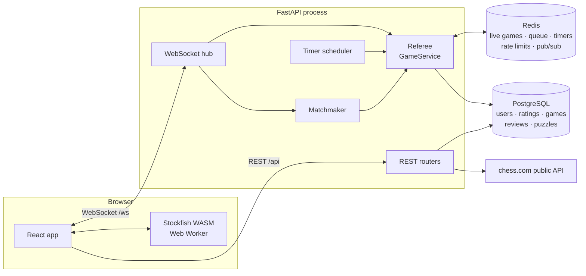
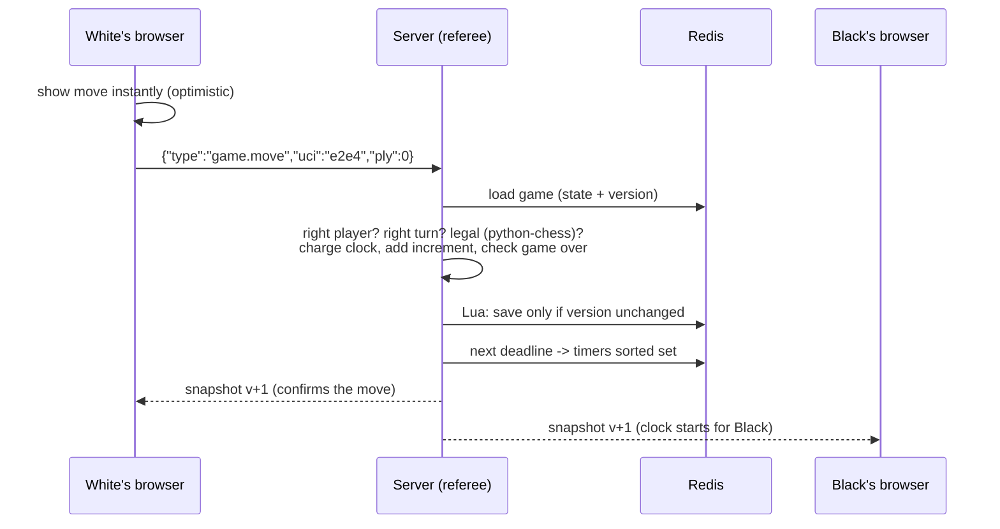

# ShahMaat — real-time chess with free, unlimited analysis

**ShahMaat** (Persian *shāh māt*, "the king is helpless": the origin of the word *checkmate*)
is a multiplayer chess site. Play rated games in real time, watch others play, then review
every game with Stockfish 17 as often as you like. Import your chess.com games and review
those too. Every mistake you make becomes a puzzle that comes back on a spaced-repetition
schedule until you've learned it.

**Backend:** Python 3.12, FastAPI, native WebSockets, PostgreSQL (SQLAlchemy 2 + Alembic), Redis (Lua scripts).
**Frontend:** React 19, Vite, Tailwind CSS 4, Stockfish 17.1 (WebAssembly).

---

## Features

**Play**
- Accounts with Argon2id passwords, or **Continue with Google** (OpenID Connect + PKCE)
- **Glicko-2 ratings** per time class (bullet / blitz / rapid), with provisional ratings
- **Matchmaking by rating**: the acceptable rating gap starts narrow and widens the longer you wait
- **Private challenge links** for friends (rated or casual, pick your colour)
- **Live games over WebSockets.** Server-run clocks with increment and lag compensation.
  Premoves, click-to-move or drag. Draw offers, resign, abort. Claim the win if your opponent
  disconnects. **Rematch**, and **spectators** (signed-in or guests).
- **Watch page** showing live games, plus a **leaderboard** of established players

**Improve**
- **Analysis board.** Stockfish 17.1 runs in your browser: unlimited, free, MultiPV lines,
  best-move arrows, and PGN/FEN import.
- **Game review.** Every move gets a label (book → best → … → blunder). You also get accuracy
  per player, **accuracy by game phase** (opening / middlegame / endgame), an evaluation graph,
  and "best was …" with the engine's line.
- **Opening names** (ECO) for every game, recognised even when the moves arrive in a different order
- **chess.com import**: browse any player's public archive and review a game here
- **Puzzles from your own mistakes.** Every mistake or blunder in your reviewed games becomes
  a puzzle. Leitner-box spaced repetition brings it back after 1, 3, 7, 21 and 60 days.
- **Play the bot**: 8 strength levels, runs locally, with takeback

**Operate**
- Structured JSON logs, request ids, Prometheus metrics, liveness and readiness checks
- Docker image, Docker Compose, a Render blueprint, and GitHub Actions CI
  (lint, type check, tests against real Postgres + Redis, dependency audit, image build)

---

## Architecture



### The rules that make it reliable

**1. The server is the referee.** The browser only *asks* to move. The server checks whose
turn it is and validates the move with python-chess. It measures the time used on its own
clock and decides when the game ends. A modified client can't make illegal moves, fake its
clock or declare itself the winner. ([`game/service.py`](backend/shahmaat/game/service.py))

**2. Every change to a live game is compare-and-set.** A live game is a Redis hash: a JSON
state plus a version number. One atomic Lua script saves a change only if the version hasn't
moved since it was read; otherwise the change is recomputed from fresh state. Some things
can arrive at the same instant: a move and a flag-fall, two resignations, two tabs sending
moves. In each case exactly one wins. No locks are held while thinking.
([`game/store.py`](backend/shahmaat/game/store.py), [`redis_client.py`](backend/shahmaat/redis_client.py))

**3. Deadlines survive restarts.** Flag-falls and first-move aborts are stored in a Redis
sorted set, which is durable. Each server also arms an in-memory timer, so a flag falls
within milliseconds. A slow sweeper catches anything a crash lost. Firing twice is harmless
because of rule 2. ([`game/timers.py`](backend/shahmaat/game/timers.py))

**4. A game is archived exactly once.** When a game ends, it's written to Postgres in the
*same transaction* as both players' rating updates. The insert is `ON CONFLICT DO NOTHING`,
so a retry can never count a rating twice. Rating rows are locked in a fixed order, so two
games finishing together can't deadlock. ([`game/archive.py`](backend/shahmaat/game/archive.py))

**5. Restarts don't end games.** Live state is in Redis, not in server memory. On startup
the server re-arms every timer and finishes archiving any game that ended mid-crash.
Browsers reconnect by themselves and get a full snapshot.

**6. It scales out with one switch.** With `MULTI_INSTANCE=true`, updates travel over
Redis pub/sub. A move made on server A then reaches a spectator connected to server B.
With one server, an in-process bus is used instead and costs zero Redis commands per move.
([`realtime/bus.py`](backend/shahmaat/realtime/bus.py))

### How one move travels



Snapshots are complete (not diffs) and carry a version number. A browser ignores anything
older than what it has, so a reconnect can never roll the board back.

### Where analysis happens

Stockfish runs **in the player's browser** (WebAssembly in a Web Worker), so analysis is
unlimited and costs the server nothing. For a game review, the browser sends its raw
evaluations to the server. The server then:

1. replays the game with python-chess,
2. throws away any engine move that isn't legal in its position,
3. scores finished positions (mates, stalemates) by the rules, ignoring what the client sent,
4. computes the move labels, accuracy and phase accuracy, and stores the review so anyone can open it,
5. turns the requester's mistakes into puzzles.

One implementation of the maths, tested once, shared by everyone.
([`chess_core/review.py`](backend/shahmaat/chess_core/review.py))

---

## Tech stack, and why

| Layer | Choice | Why |
| --- | --- | --- |
| API | **FastAPI** + Pydantic v2 | Async (thousands of idle sockets cost almost nothing). Every request body is validated, and unknown fields are rejected. |
| Realtime | **Native WebSockets** | A small JSON protocol, validated by a Pydantic discriminated union. No Socket.IO dependency. |
| Chess rules | **python-chess** | Legal moves, checkmate, repetition, the 50-move rule, PGN. Never hand-roll these. |
| Database | **PostgreSQL** + SQLAlchemy 2 (async) + **Alembic** | Relational data and transactions (game + ratings together). Migrations are versioned and run at startup. |
| Live state | **Redis** + Lua | Fast shared state, atomic compare-and-set, sorted sets for queues and timers, pub/sub for scaling out. |
| Auth | Argon2id, JWT access token, rotating refresh token | See *Security*. |
| Engine | **Stockfish 17.1 lite**, single-threaded WASM | Runs on the user's CPU. Single-threaded needs no special cross-origin headers, so it works on any host. |
| Frontend | **React 19**, Vite, Tailwind 4, react-chessboard, chess.js, zustand | A familiar stack. Pages are lazy-loaded so the first visit is small. |
| Logs / metrics | structlog (JSON), prometheus-client | Searchable logs with secrets redacted; latency, live games and connections over time. |
| Tests | pytest (+ real Postgres/Redis), Vitest, Playwright for manual end-to-end runs | The things that break in production (races, timers, restarts) are tested against the real services. |

---

## Project layout

```
backend/
  shahmaat/
    chess_core/      Pure logic, no I/O: clock.py, rules.py, glicko2.py, review.py,
                     openings.py, puzzles.py, timecontrols.py
    game/            The referee: service.py, store.py (Redis CAS), timers.py,
                     matchmaking.py, challenges.py, archive.py, lookup.py
    realtime/        WebSocket endpoint, message schemas, connection hub, message bus
    auth/            Passwords, tokens, Google OIDC, users, FastAPI dependencies
    api/             REST routers: auth, users, games, reviews, imports, puzzles
    services/        chess.com client
    security/        Rate limiting, security headers
    db/              SQLAlchemy models and session handling
    data/            Opening book (Lichess chess-openings, CC0)
    main.py          App factory: startup, shutdown, error handlers, serving the React app
  alembic/           Database migrations
  tests/             52 tests: pure logic, HTTP, two-player WebSocket games, races, timers, restarts
frontend/
  src/engine/        Stockfish worker wrapper, UCI parser, whole-game analysis
  src/lib/           API client, auth store, socket client, live-game hook, helpers
  src/components/    Board, Clock, PlayerBar, MoveList, EvalBar, EvalGraph, Layout
  src/pages/         Home, Game, Analysis, Review, Import, Bot, Puzzles, Profile, ...
Dockerfile           Multi-stage: builds the React app, then a slim non-root Python image
docker-compose.yml   App + Postgres + Redis
render.yaml          One-click Render deployment
```

---

## Run it locally

You need **Python 3.12+**, **Node 22+** and **Docker Desktop** (for Postgres and Redis).

```bash
# 1. Start Postgres and Redis in containers
docker compose -f docker-compose.dev.yml up -d
```
*Why:* you get the same databases as production without installing them on your machine.

```bash
# 2. Backend: create a virtual environment and install dependencies
cd backend
python -m venv .venv
.venv\Scripts\activate          # Windows PowerShell
# source .venv/bin/activate     # macOS / Linux
pip install -e ".[dev]"
```
*Why:* the virtual environment keeps this project's packages separate from everything else on your computer.

```bash
# 3. Configuration: copy the template, then fill in the two secrets
copy ..\.env.example .env       # Windows   (macOS/Linux: cp ../.env.example .env)
python -c "import secrets; print(secrets.token_urlsafe(48))"   # run twice, paste into JWT_SECRET and REFRESH_TOKEN_SECRET
```
*Why:* secrets live in `.env`, which `.gitignore` keeps out of Git.

```bash
# 4. Create the tables, then start the API on port 8000
alembic upgrade head
uvicorn shahmaat.main:create_app --factory --reload --port 8000
```

```bash
# 5. Frontend (new terminal)
cd frontend
npm install
npm run dev
```

Open **http://localhost:5173**. To play a real game against yourself, open a second browser
or a private window (it has separate cookies), sign up as another user, and pick the same
time control in both.

*Why two servers in development:* Vite gives instant hot reload for the React code. Its
proxy forwards `/api` and `/ws` to FastAPI, so the browser sees a single site, exactly like
production.

**Everything in Docker instead:** `cp .env.example .env`, fill in the secrets and set
`APP_ORIGIN=http://localhost:8000`. Then run `docker compose up --build` and open http://localhost:8000.

API docs (development only): http://localhost:8000/api/docs

---

## Tests

```bash
cd backend
pytest -q                     # 52 tests; needs the dev Postgres + Redis running
```

The tests create their own database (`shahmaat_test`; override with `TEST_DATABASE_URL`)
and use Redis database 15. Highlights:

- **Glicko-2** reproduces the worked example from Glickman's paper exactly
- **Full games** with two real WebSocket clients: matched, played to checkmate, ratings updated, PGN exported
- **Races:** both players resign at the same instant → one result, ratings counted once; two parallel moves → one applied
- **Clocks:** a move arriving after the flag loses on time; the server timer flags an idle player; no first move → abort
- **Restart:** the server stops mid-game, a new one starts, and play continues
- **Security:** a replayed refresh token kills the whole session, cross-site requests are refused,
  logins are rate-limited, forged tokens and smuggled message fields are rejected
- **Fair play:** no engine review while a game is still being played

```bash
cd frontend
npm test                      # UCI parsing, chess helpers, formatting
npm run lint
```

---

## Deploy for free (Render + Neon + Upstash)

A WebSocket server needs a process that stays running, so serverless hosts won't do.
This combination is free:

1. **Neon** (Postgres): create a project in the **Singapore** region and copy the connection
   string with **pooling off**. *Why:* migrations need a direct connection.
2. **Upstash** (Redis): create a database in the same region with **eviction off**. Copy the
   `rediss://` URL. *Why:* eviction could silently delete live games.
3. **Push this repo to GitHub.**
4. **Render** → New → **Blueprint** → choose the repo. It reads `render.yaml`, builds the
   `Dockerfile`, and generates both secrets for you. Paste in `DATABASE_URL`, `REDIS_URL`,
   `CHESSCOM_CONTACT` and `APP_ORIGIN=https://<your-service>.onrender.com` (no trailing slash).
5. Open `https://<your-service>.onrender.com/api/health/ready`. It should say `"ok": true`.

Free-tier limits to know: Render's free service sleeps after 15 minutes without traffic,
and the first visit after that takes about a minute. A free uptime monitor pinging `/api/health`
every 10 minutes keeps it awake. Upstash's free plan counts Redis commands; ShahMaat uses
no Redis while idle and has single-instance mode for exactly this reason.

### Continue with Google (optional)

In Google Cloud Console, create an OAuth client of type **Web application**. Add these
authorised redirect URIs:
- `<APP_ORIGIN>/api/auth/google/callback`
- `http://localhost:5173/api/auth/google/callback` (for development)

Then set `GOOGLE_CLIENT_ID` and `GOOGLE_CLIENT_SECRET`. ShahMaat requests only the `openid`
scope. It stores Google's account id and never sees your email.

---

## Environment variables

| Variable | Required | Meaning |
| --- | --- | --- |
| `DATABASE_URL` | yes | Postgres URL (`postgres://`, `postgresql://` and Neon's `?sslmode=require` all work) |
| `REDIS_URL` | yes | Redis URL (`rediss://` for TLS, e.g. Upstash) |
| `JWT_SECRET` | yes | 32+ characters, signs access tokens |
| `REFRESH_TOKEN_SECRET` | yes | 32+ characters, different from `JWT_SECRET`; HMAC key for stored refresh tokens |
| `APP_ORIGIN` | yes | Exact public URL. Only this origin may open sockets or use cookie endpoints. |
| `ENV` | no | `development` (default) or `production` (JSON logs, no API docs, strict origin checks) |
| `TRUST_PROXY` | no | `true` behind Render or another proxy, so rate limits see real client IPs |
| `MULTI_INSTANCE` | no | `true` when running 2+ instances (enables Redis pub/sub) |
| `CHESSCOM_CONTACT` | recommended | Your email or URL; chess.com asks API clients to identify themselves |
| `GOOGLE_CLIENT_ID` / `GOOGLE_CLIENT_SECRET` | no | Turn on Google sign-in |
| `METRICS_TOKEN` | no | Bearer token for `/metrics` (in production, `/metrics` is off without it) |
| `WEB_DIST` | no | Folder with the built React app; set in the Docker image |
| `LOG_LEVEL` | no | Default `INFO` |

---

## Security

| Threat | Defence | Where |
| --- | --- | --- |
| Modified client sends illegal moves, fake clocks or results | Server-authoritative rules and clocks | `game/service.py`, `chess_core/clock.py` |
| Acting as another player | User id comes only from the verified token; messages with extra fields are rejected | `realtime/protocol.py` |
| Password theft | Argon2id (OWASP parameters); unknown user and wrong password take the same time and give the same answer | `auth/passwords.py`, `api/auth.py` |
| Brute force | Redis rate limits per IP and per account | `security/ratelimit.py` |
| Stolen session | 15-minute access token kept in memory only. Refresh token is in an `httpOnly`, `SameSite=Strict` cookie scoped to `/api/auth` and rotated on every use. Replaying an old one revokes the whole login. | `auth/tokens.py` |
| Database leak | Refresh tokens are stored as HMAC-SHA256 hashes, not raw | `auth/tokens.py` |
| CSRF | SameSite=Strict cookie plus an Origin check on every cookie-authenticated endpoint | `auth/deps.py` |
| Cross-site WebSocket hijacking | Origin allow-list on the handshake; token sent in the first message, never in the URL | `realtime/endpoint.py` |
| XSS / clickjacking | React escapes output; strict Content-Security-Policy, `frame-ancestors 'none'`, nosniff, HSTS | `security/headers.py` |
| SQL injection | Parameterised queries everywhere (SQLAlchemy) | — |
| Message flooding | Per-connection token bucket, 4 KB message cap, 20 sockets per IP, slow clients disconnected | `realtime/hub.py` |
| Engine help during live games | Reviews of in-progress games are refused | `game/lookup.py` |
| Puzzle cheating | Puzzle solutions never reach the browser before you answer; the server checks | `api/puzzles.py` |
| Open redirects | `?next=` only accepts same-site paths | `pages/Auth.jsx` |

---

## Honest limits and next steps

- **Cheat detection** only blocks ShahMaat's own analysis during live games. Detecting an
  engine on another device (move-match rates, timing patterns) is an open problem even for big sites.
- **No email yet**, so there's no password reset or email verification.
- **Accuracy** uses Lichess's published formulas. chess.com's exact formula isn't public,
  so numbers differ slightly from chess.com's.
- **Bot games** are local and unrated by design (the server can't referee them).
- Ideas: tournaments (arena format), in-game chat with moderation, an opening explorer from
  played games, Sentry error tracking.

## Licences

The ShahMaat code is yours. **Stockfish is GPLv3**: the site serves Stockfish's licence at
`/stockfish/COPYING.txt` and links its source in the footer. Keep both if you deploy publicly.
Opening names come from [lichess-org/chess-openings](https://github.com/lichess-org/chess-openings) (CC0).
